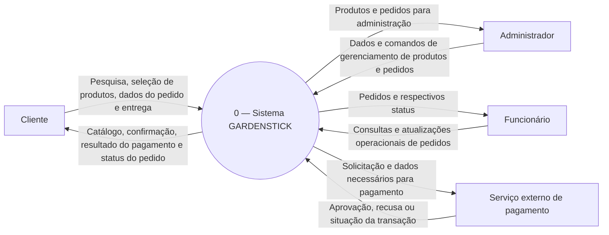
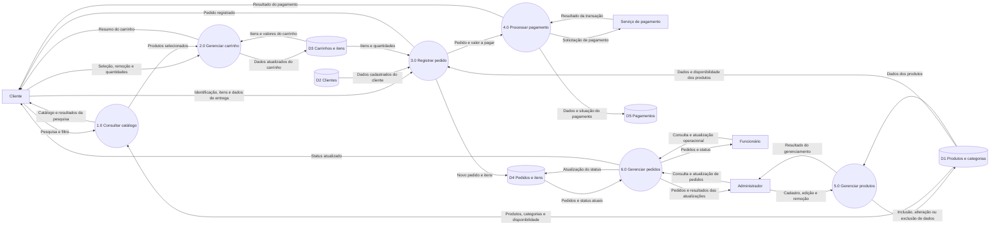

# GARDENSTICK 🌷
# Análise Estruturada — Diagramas de Fluxo de Dados e Dicionário de Dados

## 1. Objetivo

Este documento representa como as informações entram, são processadas, armazenadas e saem do sistema GARDENSTICK. Os diagramas foram elaborados com base nos requisitos funcionais RF01 a RF08 e na arquitetura planejada do projeto.

## 2. Revisão do feedback da avaliação intermediária

O texto ou arquivo com o feedback da avaliação intermediária não foi localizado no material do projeto disponível durante esta revisão. Por esse motivo, não é possível afirmar quais observações específicas do professor foram atendidas.

A documentação desta etapa foi revisada com base nos requisitos e no escopo registrados em `docs/requisitos-e-escopo.md`. Quando o feedback original estiver disponível, suas observações deverão ser conferidas individualmente e registradas neste documento.

## 3. Diagrama de contexto

O diagrama de contexto apresenta a GARDENSTICK como um único processo e mostra as entidades externas que trocam informações com o sistema.

### Entidades externas

- **Cliente:** consulta produtos, envia dados do carrinho e do pedido, fornece dados de entrega e recebe informações de pagamento e acompanhamento.
- **Administrador:** envia dados para cadastrar, editar ou remover produtos e solicita informações e atualizações de pedidos.
- **Funcionário:** consulta pedidos e envia atualizações operacionais de status, conforme suas permissões.
- **Serviço de pagamento:** recebe solicitações de pagamento e retorna o resultado do processamento.

### Diagrama

## 4. DFD — Nível 0

O DFD de nível 0 detalha os principais processos do sistema, os fluxos de dados e os depósitos de armazenamento. Os processos representam funcionalidades previstas nos requisitos, não funcionalidades já concluídas no protótipo.

### Processos

- **1.0 Consultar catálogo:** apresenta produtos e permite pesquisa por nome e categoria (RF01 e RF02).
- **2.0 Gerenciar carrinho:** recebe produtos selecionados, permite alterar quantidades e remover itens (RF03).
- **3.0 Registrar pedido:** recebe os dados do cliente, os itens e as informações de entrega e registra o pedido (RF04).
- **4.0 Processar pagamento:** encaminha a solicitação ao serviço externo e registra o resultado (RF05).
- **5.0 Gerenciar produtos:** permite ao administrador cadastrar, editar e remover produtos (RF07).
- **6.0 Gerenciar pedidos:** permite consultar pedidos e atualizar seus status (RF06 e RF08).

### Depósitos de dados

- **D1 — Produtos e categorias:** cadastro, descrição, preço, categoria e disponibilidade em estoque.
- **D2 — Clientes:** dados de identificação e contato dos clientes.
- **D3 — Carrinhos e itens:** produtos selecionados, quantidades e valores.
- **D4 — Pedidos e itens do pedido:** identificação, data, cliente, itens, endereço de entrega, valor total e status.
- **D5 — Pagamentos:** identificador da transação, valor, método e situação do pagamento.

### Diagrama

## 5. Dicionário de dados

O dicionário descreve os principais conjuntos de dados utilizados nos fluxos e depósitos do DFD. Os tipos e tamanhos são propostas de estrutura para uma futura implementação com banco de dados relacional; não significam que essas tabelas já existam no protótipo atual.

### 5.1 Cliente

| Campo | Tipo | Tamanho/forma | Descrição |
|---|---|---|---|
| id_cliente | Inteiro | INT | Identificador único do cliente. |
| nome | Texto | VARCHAR(100) | Nome completo do cliente. |
| email | Texto | VARCHAR(100) | Endereço de e-mail para contato. |
| telefone | Texto | VARCHAR(20) | Telefone do cliente. |
| cpf | Texto | VARCHAR(14) | Documento de identificação do cliente. |
| endereco | Texto | VARCHAR(200) | Endereço utilizado para entrega. |

### 5.2 Produto

| Campo | Tipo | Tamanho/forma | Descrição |
|---|---|---|---|
| id_produto | Inteiro | INT | Identificador único do produto. |
| nome | Texto | VARCHAR(100) | Nome da flor, planta ou arranjo. |
| descricao | Texto | VARCHAR(500) | Detalhes e características do produto. |
| preco | Decimal | DECIMAL(10,2) | Preço de venda do produto. |
| quantidade_estoque | Inteiro | INT | Quantidade disponível em estoque. |
| id_categoria | Inteiro | INT | Identificador da categoria relacionada. |
| imagem | Texto | VARCHAR(255) | Caminho ou endereço da imagem do produto. |

### 5.3 Categoria

| Campo | Tipo | Tamanho/forma | Descrição |
|---|---|---|---|
| id_categoria | Inteiro | INT | Identificador único da categoria. |
| nome | Texto | VARCHAR(60) | Nome da categoria, como Flores, Plantas ou Arranjos. |
| descricao | Texto | VARCHAR(200) | Descrição dos produtos agrupados. |

### 5.4 Carrinho

| Campo | Tipo | Tamanho/forma | Descrição |
|---|---|---|---|
| id_carrinho | Inteiro | INT | Identificador único do carrinho. |
| id_cliente | Inteiro | INT | Cliente proprietário do carrinho, quando identificado. |
| data_criacao | Data e hora | DATETIME | Data e horário de criação. |
| valor_total | Decimal | DECIMAL(10,2) | Soma dos itens do carrinho. |

### 5.5 ItemCarrinho

| Campo | Tipo | Tamanho/forma | Descrição |
|---|---|---|---|
| id_item_carrinho | Inteiro | INT | Identificador único do item. |
| id_carrinho | Inteiro | INT | Carrinho ao qual o item pertence. |
| id_produto | Inteiro | INT | Produto selecionado. |
| quantidade | Inteiro | INT | Quantidade selecionada. |
| preco_unitario | Decimal | DECIMAL(10,2) | Preço do produto no momento da inclusão. |
| subtotal | Decimal | DECIMAL(10,2) | Resultado de quantidade multiplicada pelo preço unitário. |

### 5.6 Pedido

| Campo | Tipo | Tamanho/forma | Descrição |
|---|---|---|---|
| id_pedido | Inteiro | INT | Identificador único do pedido. |
| id_cliente | Inteiro | INT | Cliente que realizou o pedido. |
| data_pedido | Data e hora | DATETIME | Data e horário do registro. |
| endereco_entrega | Texto | VARCHAR(200) | Endereço informado para entrega. |
| valor_total | Decimal | DECIMAL(10,2) | Valor total do pedido. |
| status | Texto | VARCHAR(30) | Situação atual, como recebido, em preparação ou enviado. |

### 5.7 ItemPedido

| Campo | Tipo | Tamanho/forma | Descrição |
|---|---|---|---|
| id_item_pedido | Inteiro | INT | Identificador único do item do pedido. |
| id_pedido | Inteiro | INT | Pedido ao qual o item pertence. |
| id_produto | Inteiro | INT | Produto incluído no pedido. |
| quantidade | Inteiro | INT | Quantidade comprada. |
| preco_unitario | Decimal | DECIMAL(10,2) | Preço unitário registrado na compra. |
| subtotal | Decimal | DECIMAL(10,2) | Quantidade multiplicada pelo preço unitário. |

### 5.8 Pagamento

| Campo | Tipo | Tamanho/forma | Descrição |
|---|---|---|---|
| id_pagamento | Inteiro | INT | Identificador único do pagamento. |
| id_pedido | Inteiro | INT | Pedido relacionado ao pagamento. |
| identificador_transacao | Texto | VARCHAR(100) | Código de referência retornado pelo serviço de pagamento. |
| forma_pagamento | Texto | VARCHAR(30) | Método utilizado, como Pix ou cartão. |
| valor | Decimal | DECIMAL(10,2) | Valor solicitado para pagamento. |
| status | Texto | VARCHAR(30) | Situação, como pendente, aprovado ou recusado. |
| data_pagamento | Data e hora | DATETIME | Data e horário do processamento, quando disponível. |

## 6. Comparação entre DFD/DD e a implementação atual

A comparação foi realizada com os arquivos existentes no repositório: `index.html`, `script.js`, `style.css`, README e documentos de requisitos, arquitetura e UML.

| Área | Previsto no DFD/requisitos | Implementação encontrada | Divergência / situação |
|---|---|---|---|
| Catálogo | Consultar produtos, categorias, preços e imagens. | Catálogo estático com seis produtos, nome, categoria e preço. | Parcial: não há cadastro dinâmico, descrição ou imagens vinculadas aos dados. |
| Pesquisa e filtro | Pesquisar por nome e filtrar por categoria (RF02). | Pesquisa por nome e filtro por categoria em JavaScript. | Atendido no protótipo. |
| Clientes | Armazenar dados de identificação e contato. | Não há cadastro nem persistência de clientes. | Pendente de implementação. |
| Estoque | Consultar disponibilidade e controlar quantidades. | Não há controle de estoque persistente. | Pendente de implementação. |
| Carrinho | Adicionar, remover e alterar quantidades (RF03). | Não há carrinho funcional. | Pendente de implementação. |
| Pedidos | Registrar pedido e dados de entrega (RF04). | Não há registro persistente de pedidos. | Pendente de implementação. |
| Pagamentos | Integrar serviço externo e registrar retorno (RF05). | Não há integração de pagamento. | Pendente de implementação. |
| Acompanhamento | Consultar status dos pedidos (RF06). | Não há consulta de pedidos ou status. | Pendente de implementação. |
| Administração | Cadastrar, editar e remover produtos (RF07). | Não há painel administrativo nem operações de cadastro. | Pendente de implementação. |
| Gestão de pedidos | Consultar pedidos e atualizar status (RF08). | Não há gerenciamento de pedidos. | Pendente de implementação. |
| Depósitos de dados | Persistir clientes, produtos, carrinhos, pedidos e pagamentos. | Os produtos do protótipo estão definidos em arrays no JavaScript e também há conteúdo inicial no HTML; não foi encontrada integração com banco de dados. | Divergência entre arquitetura planejada e estágio atual. |

## 7. Correções e ajustes realizados

1. Foi criada esta documentação com diagrama de contexto, DFD nível 0 e dicionário de dados com oito conjuntos de dados.
2. Os processos e fluxos foram relacionados aos requisitos RF01 a RF08.
3. Foi registrada a diferença entre o sistema planejado e o protótipo realmente implementado.
4. Foi mantida a descrição do projeto como protótipo funcional de catálogo, sem declarar como concluídas as funcionalidades futuras.
5. Não foi adicionada uma falsa implementação de banco de dados, carrinho, pedidos, pagamentos ou área administrativa. Essas funcionalidades dependem de desenvolvimento futuro.
6. A implementação existente de catálogo, pesquisa e filtro foi preservada, pois atende à parte já iniciada do escopo.
7. O feedback intermediário permanece aguardando o documento ou texto original para uma revisão específica.

## 8. Considerações finais

Os diagramas e o dicionário de dados fornecem uma visão estruturada das informações que circulam pela GARDENSTICK. A comparação com o protótipo mostra que a pesquisa e o filtro do catálogo já funcionam, enquanto as demais operações continuam como parte do planejamento. Essa distinção orienta as próximas etapas sem confundir requisitos definidos com funcionalidades efetivamente entregues.
